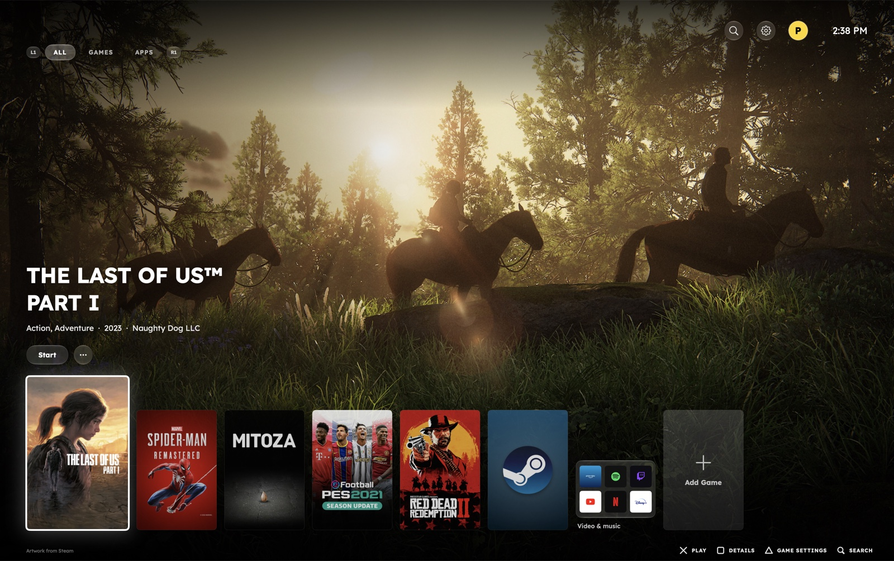
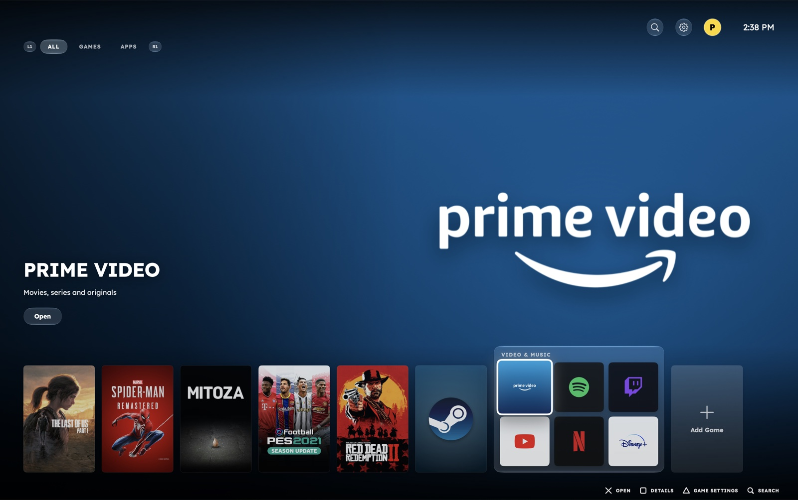
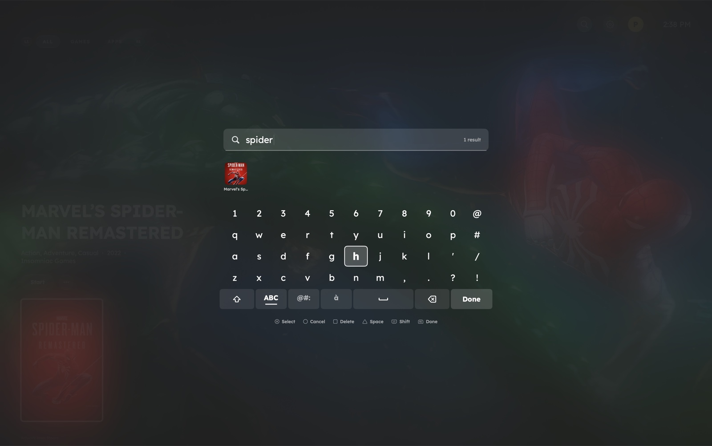
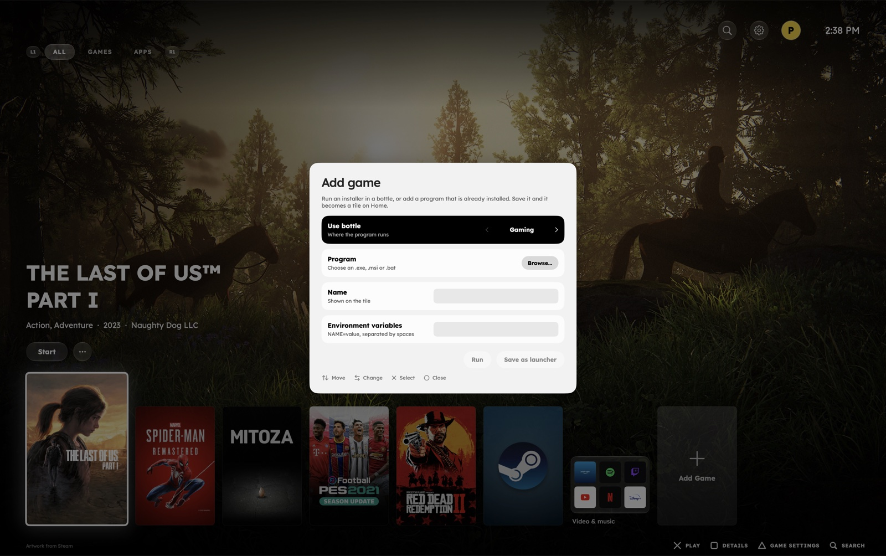
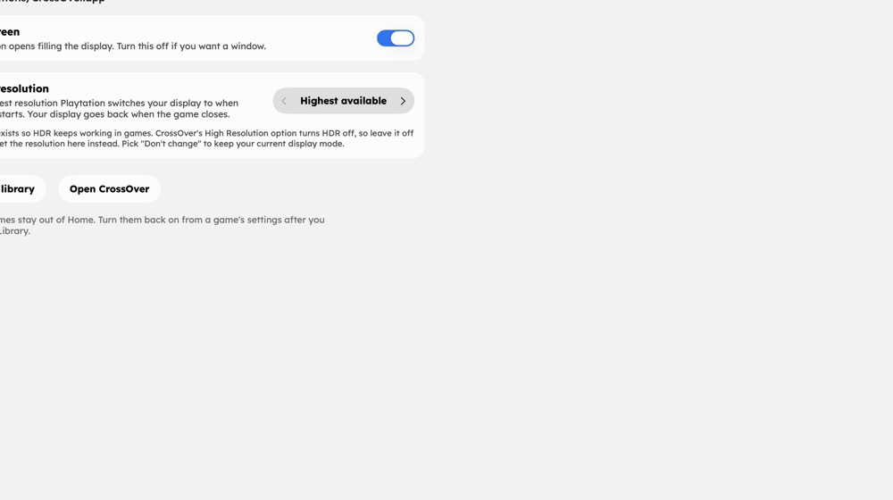
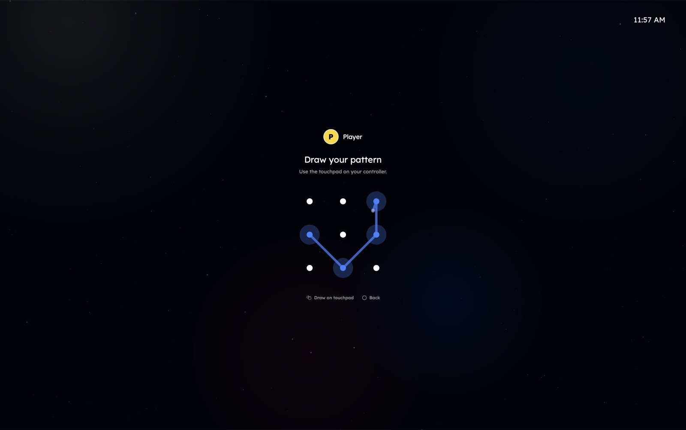
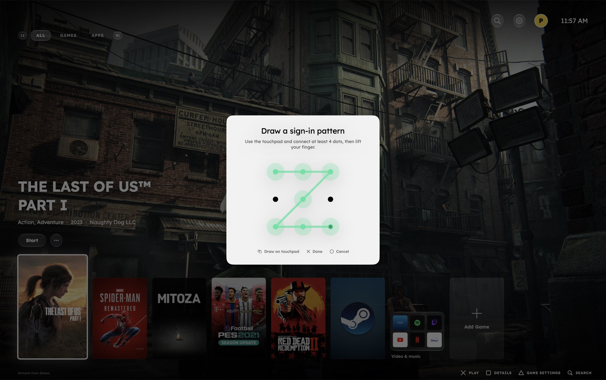
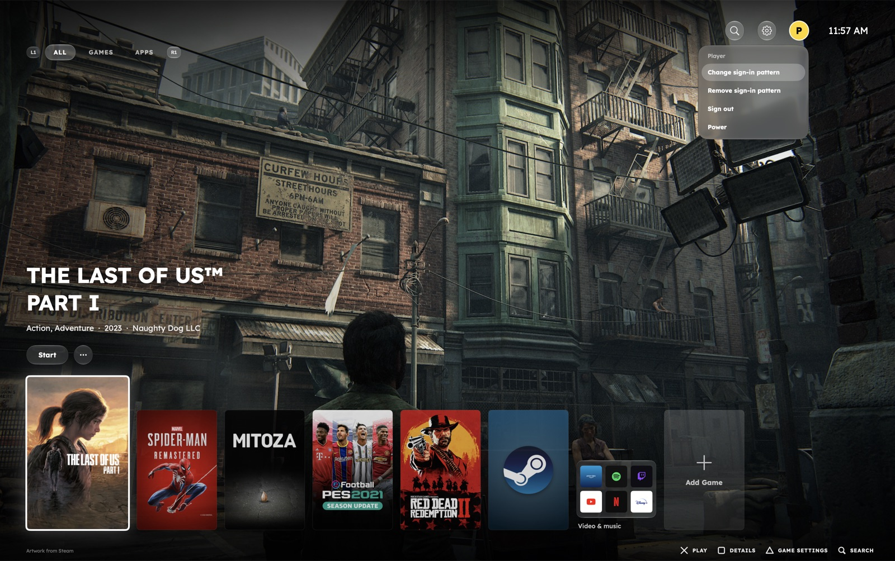

<p align="center">
  
</p>

<h1 align="center">Playtation</h1>

<p align="center">
  <b>Your Windows games on the Mac, on a console-style home screen.</b><br>
  Sit back, pick up a controller, press <b>✕</b>.
</p>

<p align="center">
  <a href="https://github.com/aliadelelroby/playtation/releases/latest"></a>
  
  
</p>

<p align="center">
  <a href="#get-playing-in-5-minutes">Get playing</a> ·
  <a href="#a-tour">Tour</a> ·
  <a href="#controller-cheat-sheet">Controls</a> ·
  <a href="#troubleshooting">Help</a> ·
  <a href="CONTRIBUTING.md">Contribute</a>
</p>

<p align="center">
  
</p>

---

Playtation is a front end for [CrossOver](https://www.codeweavers.com/crossover). It finds the games you
already run through CrossOver and Steam, lays them out like a console dashboard, and launches them with
your controller. No more hunting through Finder and bottle folders.

> Playtation is an independent fan project. It is not affiliated with Sony, CodeWeavers or Valve.

## A tour

<table>
  <tr>
    <td width="50%"></td>
    <td width="50%"></td>
  </tr>
  <tr>
    <td><b>Apps shelf.</b> Steam, Spotify, YouTube, Twitch, Netflix, Disney+ and Prime Video sit in one grouped shelf and open from the same row.</td>
    <td><b>Search with a controller.</b> A PS-style keyboard filters your library as you type.</td>
  </tr>
  <tr>
    <td width="50%"></td>
    <td width="50%"></td>
  </tr>
  <tr>
    <td><b>Add Game.</b> Run an installer or save any program as a launcher, with its own environment variables.</td>
    <td><b>Game resolution.</b> Choose the maximum resolution games run at, and keep HDR working.</td>
  </tr>
  <tr>
    <td width="50%"></td>
    <td width="50%"></td>
  </tr>
  <tr>
    <td><b>Sign-in pattern.</b> Lock your profile with an Android-style pattern, drawn on the DualSense touchpad.</td>
    <td><b>Set it in seconds.</b> Draw it twice to confirm. Change or remove it at any time.</td>
  </tr>
  <tr>
    <td width="50%"></td>
    <td><b>Profile menu.</b> Select your picture on Home to set, change or remove your pattern, sign out, or open the power menu.</td>
  </tr>
</table>

## What you get

- 🎮 **A console-style home**: big artwork, a tile row, and Liquid Glass buttons on macOS 26.
- 🔎 **Your library, automatic**: CrossOver Start Menu entries and Steam games (even on other drives)
  appear on their own, and new installs show up while Playtation is open.
- 🖼️ **Artwork and details** fetched for every game, with careful matching so a sequel or a soundtrack
  never takes the place of the right game.
- 🧰 **Apps shelf**: Steam and other launchers, plus Spotify, YouTube, Twitch, Netflix, Disney+ and
  Prime Video.
- ➕ **Add Game**: run an installer, or save any program as a launcher with its own environment variables.
- 🕹️ **Made for controllers**: DualSense and other pads, an on-screen keyboard for search, haptics.
- 🔒 **Sign-in pattern**: lock your profile with a pattern you draw on the controller's touchpad.
- 🖥️ **Resolution that suits your games**: pick the maximum resolution Playtation switches to, and your
  display goes back afterwards. This keeps HDR working, which CrossOver's *High Resolution* option turns off.

## Get playing in 5 minutes

### 1. Install CrossOver and your games

Playtation launches games through [CrossOver](https://www.codeweavers.com/crossover), so install it first
(the free trial works). Then add your games the way you normally would:

- **Steam**: install the Windows Steam client into a CrossOver bottle, sign in, and install games.
- **Other stores or setup files**: use CrossOver's *Install* button, or Playtation's **Add Game** tile later.

### 2. Install Playtation

1. Download **Playtation-1.0-macOS.zip** from the [latest release](https://github.com/aliadelelroby/playtation/releases/latest).
2. Unzip it and drag **Playtation** into your **Applications** folder.
3. Open it. The first time, macOS will say it can't verify the app, because it isn't notarized yet.
   Fix it once:
   - Right-click **Playtation** → **Open** → **Open**, or
   - open **System Settings → Privacy & Security** and click **Open Anyway**, or
   - run `xattr -dr com.apple.quarantine /Applications/Playtation.app` in Terminal.

### 3. Allow access

Playtation asks for **Screen Recording** and **Accessibility** access. It uses them only to find a game's
window, bring it to the front and make it full screen. You can grant them in
**System Settings → Privacy & Security**. Restart Playtation afterwards.

### 4. Connect a controller and play

Connect a DualSense (USB or Bluetooth) or another controller, press the **PS button** (or click) on the
welcome screen, pick a game and press **✕**. That's it. Pulling **R2** also starts the highlighted game.

Don't see your games? Open **Settings → System → Rescan library**, and check that the game has a
Start Menu entry in CrossOver (or is installed through Steam in a bottle).

## Controller cheat sheet

| Button | Does |
| --- | --- |
| D-pad / left stick | Move around |
| ✕ | Select, start a game |
| ○ | Back, clear search |
| □ | Game details |
| △ | Game settings |
| L1 / R1 | Switch category (All, Games, Apps) |
| R2 | Start the highlighted game |
| PS / Options | Open the PS menu |
| Touchpad | Draw your sign-in pattern (lift your finger to finish) |

On the home screen, pick the magnifier for a PS-style keyboard. Every screen shows its own button hints.

## Lock your profile with a pattern

Select your picture at the top right of Home and choose **Set sign-in pattern** (it's also under
**Settings → System**). Draw a pattern of at least 4 dots on the touchpad, lift your finger, then draw it
again to confirm. From then on, Playtation asks for it after you pick your profile.

Patterns work like Android: one continuous line, each dot used once, and passing straight over an unused
dot includes it. The pattern keeps casual hands off your profile; it doesn't protect your Mac account.

## Add a game yourself

Select the **Add Game** tile at the end of the Games row:

1. Choose the **bottle** and the **program** (`.exe`, `.msi` or `.bat`).
2. Optionally give it a **name** and **environment variables** (`NAME=value`, separated by spaces).
3. Press **Run** to run an installer, or **Save as launcher** to put it on Home.

To remove a game, open its **…** menu and choose **Remove**. Playtation hides it, or deletes a launcher
you saved. It never deletes your game files.

## Requirements

- A Mac with **macOS 14** or later (Liquid Glass looks need **macOS 26**). Apple silicon and Intel.
- **CrossOver** installed in `/Applications` or `~/Applications`.
- A game controller is recommended but not required.

## Troubleshooting

<details>
<summary><b>"Playtation can't be opened because Apple cannot check it for malicious software"</b></summary>

The app is signed for local use but not notarized. Use one of the three options in step 2 above.
</details>

<details>
<summary><b>My game doesn't appear</b></summary>

Playtation reads CrossOver's Start Menu and Steam libraries. Make sure the game has a Start Menu entry in
its bottle, or is installed through Steam inside a bottle, then use **Settings → System → Rescan library**.
You can always add it by hand with **Add Game**.
</details>

<details>
<summary><b>The game doesn't come to the front or full screen</b></summary>

Check that Playtation has **Screen Recording** and **Accessibility** access in System Settings, then restart it.
</details>

<details>
<summary><b>Wrong or missing artwork and details</b></summary>

Playtation matches the shortcut's name against Steam (and RAWG, if you add a key). Give the game a clearer
name, or add a free [RAWG key](https://rawg.io/apidocs) by exporting `RAWG_API_KEY` or saving it to
`~/Library/Application Support/Playtation/rawg.key`.
</details>

<details>
<summary><b>HDR turns off when I start a game</b></summary>

Leave CrossOver's *High Resolution* option off and choose a maximum under **Settings → System → Game resolution**.
</details>

<details>
<summary><b>I forgot my sign-in pattern</b></summary>

Run `defaults delete com.playtation.Playtation signInPattern` in Terminal, then restart Playtation.
</details>

<details>
<summary><b>Where is my data?</b></summary>

`~/Library/Application Support/Playtation/` holds play history, hidden games, saved launchers and cached
artwork. Delete that folder to start fresh. Your games are untouched.
</details>

## Build from source

```sh
git clone https://github.com/aliadelelroby/playtation.git
cd playtation
brew install xcodegen
xcodegen generate
open Playtation.xcodeproj
```

Run the tests with `xcodebuild -project Playtation.xcodeproj -scheme Playtation test`. To make a release zip,
see [docs/RELEASING.md](docs/RELEASING.md).

### Project layout

```
Playtation/
  App/        App entry point, shell, boot and welcome screens
  Model/      ConsoleModel (split by concern), game and bottle types
  Library/    CrossOver and Steam scanning, launchers, file watching, media apps
  Metadata/   Title matching, store clients, artwork cache
  Input/      Controller binding, DualSense HID, haptics, permissions
  System/     Display resolution and game window focus
  Audio/      UI sounds and music
  UI/         Home, Settings, overlays, theme and artwork rendering
  Resources/  Assets, fonts, sounds, logos, Info.plist
ControllerAgent/  Login-item helper that catches the PS button
Tests/            Unit tests
```

[docs/ARCHITECTURE.md](docs/ARCHITECTURE.md) explains how the pieces fit together.

## Contributing

Bug reports, ideas and pull requests are welcome. Start with [CONTRIBUTING.md](CONTRIBUTING.md).

## Licenses and trademarks

Playtation is MIT licensed ([LICENSE](LICENSE)). Bundled fonts are under the SIL Open Font License
(`Playtation/Resources/Fonts/OFL.txt`). Service logos belong to their owners and are used only to identify
each service; see `Playtation/Resources/Logos/README.md`.
